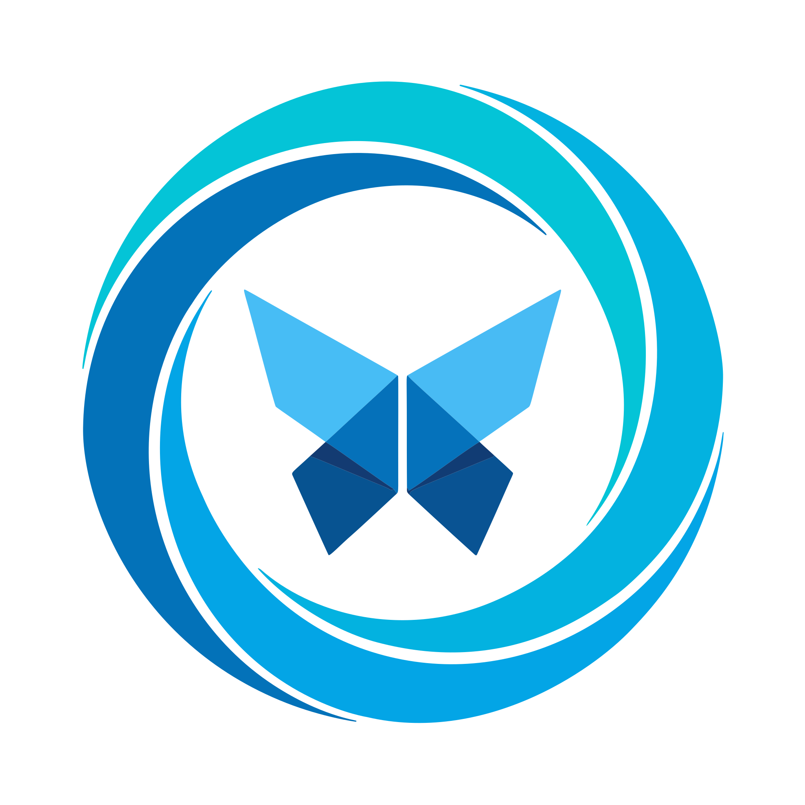

<p align="center">
  
</p>

<h1 align="center">Dartvex</h1>

<p align="center">
  Dart packages for <a href="https://convex.dev">Convex</a> — pure-Dart realtime sync, type-safe codegen, Flutter widgets, and offline support.
</p>

<p align="center">
  <a href="https://github.com/AndreFrelicot/dartvex/actions/workflows/ci.yml"></a>
  <a href="https://opensource.org/licenses/MIT"></a>
  <a href="https://dart.dev"></a>
  <a href="https://pub.dev/publishers/andrefrelicot.dev/packages"></a>
</p>

<p align="center">
  
</p>

---

## Why Dartvex?

- **Pure-Dart core** — the `dartvex` client has no Rust FFI or Flutter
  dependency; companion packages add Flutter/native integrations where noted.
- **Type-safe codegen** — Generate Dart bindings from your deployed Convex functions' validators. Catch errors at compile time.
- **Flutter widgets** — `ConvexProvider`, `ConvexQuery`, `ConvexMutation` and more for reactive UI.
- **Offline capable** — SQLite query cache and mutation queue with optimistic patches for queued writes.
- **Multi-platform** — iOS, Android, web, macOS, Linux, Windows.

Web support covers the core realtime client, auth, storage URL resolution, and
Flutter query/mutation widgets. Disk-backed file/image cache and offline image
fallback are native-only because they rely on `dart:io` and local filesystem
storage.

## Quick Start

```dart
import 'package:dartvex/dartvex.dart';

void main() async {
  final client = ConvexClient('https://your-deployment.convex.cloud');

  // Subscribe to a query
  final sub = client.subscribe('messages:list', {});
  sub.stream.listen((result) {
    if (result case QuerySuccess(:final value)) {
      print('Messages: $value');
    }
  });

  // Run a mutation
  await client.mutate('messages:send', {'body': 'Hello from Dart!'});
}
```

## Packages

| Package | Description | Version |
|---------|-------------|---------|
| [`dartvex`](packages/dartvex/) | Core client — WebSocket sync, subscriptions, auth | 0.3.0 |
| [`dartvex_flutter`](packages/dartvex_flutter/) | Flutter widgets — Provider, Query, Mutation | 0.3.0 |
| [`dartvex_codegen`](packages/dartvex_codegen/) | CLI code generator — type-safe Dart bindings from function validators | 0.3.0 |
| [`dartvex_local`](packages/dartvex_local/) | Offline support — SQLite cache, mutation queue | 0.3.0 |
| [`dartvex_auth_better`](packages/dartvex_auth_better/) | Better Auth adapter | 0.3.0 |

Packages are versioned and released independently. Minimum SDKs: `dartvex`
and `dartvex_auth_better` Dart 3.6, `dartvex_codegen` Dart 3.7,
`dartvex_local` Dart 3.10, `dartvex_flutter` Dart 3.10 / Flutter 3.38.1
(iOS 15 / macOS 12 on Apple platforms).

**Convex compatibility:** Dartvex 0.3.0 implements the sync protocol of the
official Convex JavaScript client **1.49.0** (`convexSyncApiVersion`, sent
as the default API version); behavior described as matching "the official
client" refers to that release.

## Agent Skills

This repo ships [Agent Skills](https://agentskills.io) that teach AI coding
agents (Claude Code, Cursor, Copilot, Codex, …) how to build apps with
Dartvex:

```bash
npx skills add AndreFrelicot/dartvex
```

| Skill | Use it to |
|-------|-----------|
| `dartvex` | Route any Dartvex task to the right skill |
| `dartvex-quickstart` | Connect a Dart/Flutter app to Convex |
| `dartvex-generate-bindings` | Generate a type-safe API with `dartvex_codegen` |
| `dartvex-setup-auth` | Better Auth login, session restore, manual JWT auth |
| `dartvex-build-realtime-ui` | Live queries, optimistic mutations, pagination widgets |
| `dartvex-setup-offline` | SQLite cache and offline mutation queue |
| `dartvex-upload-files` | Convex file storage and cached image widgets |
| `dartvex-test-with-fakes` | Widget tests with `FakeConvexClient` |

They pair with the official [`convex/agent-skills`](https://github.com/convex/agent-skills)
(backend authoring) and [`flutter/skills`](https://github.com/flutter/skills)
(general Flutter UI).

## Architecture

```text
┌─────────────────────────────────────────────────────────────────────────────┐
│                                  Your App                                   │
├────────────────────────┬──────────────────────┬─────────────────────────────┤
│ dartvex_flutter        │ dartvex_local        │ dartvex_auth_*              │
│ (widgets)              │ (offline)            │ (better auth adapters)      │
├────────────────────────┴──────────────────────┴─────────────────────────────┤
│                                  dartvex                                    │
│                     (core client + WebSocket sync)                          │
├─────────────────────────────────────────────────────────────────────────────┤
│                              Convex Backend                                 │
└─────────────────────────────────────────────────────────────────────────────┘

                              dartvex_codegen
          (typed bindings from the deployed functions' spec)
```

## Installation

### 1. Add dependencies

```yaml
# pubspec.yaml
dependencies:
  dartvex: ^0.3.0
  dartvex_flutter: ^0.3.0  # If using Flutter

dev_dependencies:
  dartvex_codegen: ^0.3.0  # For code generation
```

### 2. Configure your client

```dart
import 'package:dartvex/dartvex.dart';
import 'package:dartvex_flutter/dartvex_flutter.dart';

final client = ConvexClient('https://your-deployment.convex.cloud');
final runtime = ConvexClientRuntime(client);

class MyApp extends StatelessWidget {
  @override
  Widget build(BuildContext context) {
    return ConvexProvider(
      client: runtime,
      child: MaterialApp(home: HomePage()),
    );
  }
}
```

### 3. Generate type-safe bindings

```bash
# From the Convex project directory: reads the functions deployed to its
# dev deployment (push changes with `npx convex dev` first).
dart run dartvex_codegen generate \
  --project path/to/convex-backend \
  --output lib/convex_api/

# Or from an exported (and scrubbed) spec file:
dart run dartvex_codegen generate \
  --spec-file path/to/function_spec.json \
  --output lib/convex_api/
```

Below a `ConvexProvider`, build the typed API with
`ConvexApi(ConvexProvider.of(context).functionCaller)`.

### 4. Use in your widgets

```dart
ConvexQuery<List<Message>>(
  query: 'messages:list',
  args: const {},
  decode: (v) => [
    for (final item in v as List) Message.fromJson(item as Map<String, dynamic>),
  ],
  builder: (context, snapshot) {
    if (snapshot.isLoading) return const CircularProgressIndicator();
    if (snapshot.hasError) return Text('Error: ${snapshot.error}');
    final messages = snapshot.data ?? const <Message>[];
    return ListView(children: messages.map(MessageTile.new).toList());
  },
)
```

## Usage Examples

### Queries

```dart
final sub = client.subscribe('tasks:list', {'projectId': 'abc123'});
sub.stream.listen((result) {
  if (result case QuerySuccess(:final value)) {
    print('Tasks: $value');
  }
});
```

### Mutations

```dart
await client.mutate('tasks:create', {
  'title': 'Ship dartvex',
  'projectId': 'abc123',
});
```

### Actions

```dart
final result = await client.action('ai:summarize', {
  'documentId': 'doc456',
});
```

### Authentication

```dart
final authClient = BetterAuthClient(
  baseUrl: 'https://your-deployment.convex.cloud',
);
final provider = ConvexBetterAuthProvider(client: authClient)
  ..email = 'user@example.com'
  ..password = 'securePassword';

final client = ConvexClient('https://your-deployment.convex.cloud');
final authedClient = client.withAuth(provider);
await authedClient.login();

// Sign out through the wrapper, so the Convex client is signed out too:
await authedClient.logout();
```

Any other OIDC provider (or JWTs minted by your deployment with
`ctx.auth.signJwt`) works through `client.setAuthWithRefresh(...)`.

### Offline Support

```dart
import 'package:dartvex_local/dartvex_local.dart';
import 'package:path_provider/path_provider.dart';

final remoteClient = ConvexClient('https://your-deployment.convex.cloud');
// Use a persistent app directory: relative paths fail on iOS/Android, and a
// temp directory loses the offline queue.
final dir = await getApplicationSupportDirectory();
final store = await SqliteLocalStore.open('${dir.path}/my_app.sqlite');
final localClient = await ConvexLocalClient.open(
  client: remoteClient,
  config: LocalClientConfig(
    cacheStorage: store,
    queueStorage: store,
    disposeRemoteClient: true,
  ),
);

// While the remote is not connected, query() returns the cached value (and
// without one waits at most refreshQueryTimeout); subscriptions are seeded
// from the cache. Mutations made offline are queued and replayed in order,
// and mutate() reports the outcome as a LocalMutationResult.
```

The local-first query cache and mutation queue use SQLite and are intended for
native targets. For files on web, resolve signed Convex storage URLs and render
them directly; disk-backed file cache/offline image fallback is not supported on
web in this release.

## Contributing

See [CONTRIBUTING.md](CONTRIBUTING.md) for guidelines.

## License

MIT License - see [LICENSE](LICENSE) for details.
