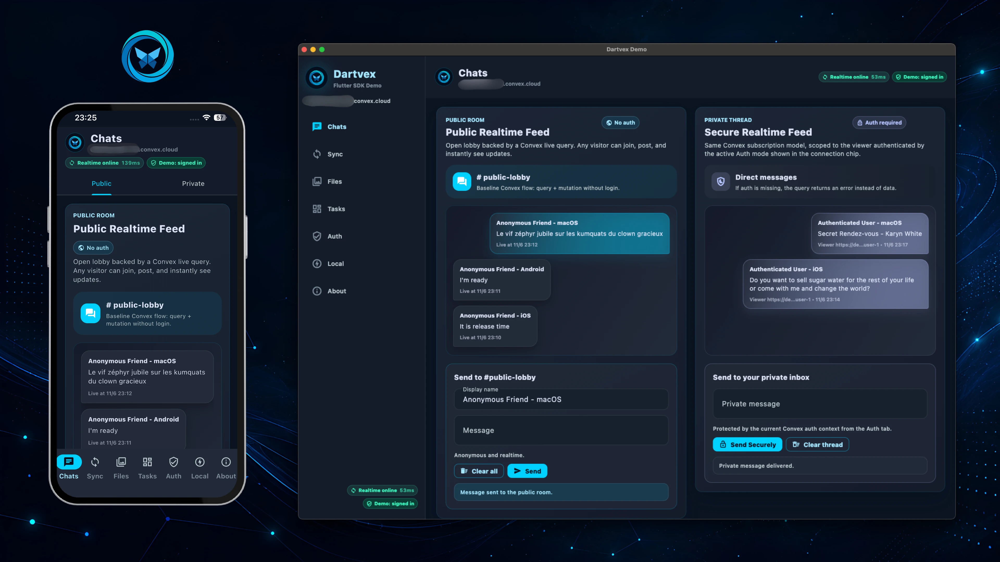

<p align="center">
  <a href="https://github.com/AndreFrelicot/dartvex">
    
  </a>
</p>

# dartvex_local

Offline-capable extension for [dartvex](https://pub.dev/packages/dartvex) — the pure Dart client for [Convex](https://convex.dev). SQLite query cache and mutation queue with optimistic updates.

<p align="center">
  <a href="https://github.com/AndreFrelicot/dartvex">
    
  </a>
</p>

## The Dartvex ecosystem

| Package | Description |
|---------|-------------|
| [`dartvex`](https://pub.dev/packages/dartvex) | Core client — WebSocket sync, subscriptions, auth |
| [`dartvex_flutter`](https://pub.dev/packages/dartvex_flutter) | Flutter widgets — Provider, Query, Mutation |
| [`dartvex_codegen`](https://pub.dev/packages/dartvex_codegen) | CLI code generator — type-safe Dart bindings from schema |
| **[`dartvex_local`](https://pub.dev/packages/dartvex_local)** | Offline support — SQLite cache, mutation queue |
| [`dartvex_auth_better`](https://pub.dev/packages/dartvex_auth_better) | Better Auth adapter |

Source and full docs: [github.com/AndreFrelicot/dartvex](https://github.com/AndreFrelicot/dartvex)

## What it does

- **Query cache** — remote query results are persisted in SQLite. While the
  remote is not connected, `query()` returns the cached value right away (and
  without one waits at most `refreshQueryTimeout` for the remote); a
  retryable remote failure also falls back to the cache.
- **Offline mutation queue** — mutations issued while offline (forced, or
  while the remote is not connected) are queued and replayed in order when
  connectivity resumes.
- **At-least-once replay** — queued mutations can be retried after ambiguous
  network failures, so server mutations should be idempotent when they trigger
  external side effects.
- **Optimistic updates for queued mutations** — app-defined
  `LocalMutationHandler` patches are applied to the cache as soon as a
  mutation is queued (offline, behind other queued mutations, or after a
  retryable failure), before it reaches the server. A mutation sent directly
  while online is not patched locally; for instant feedback on that path use
  the core client's optimistic updates (`ConvexClient.mutate`).
- **Deterministic network mode** — `setNetworkMode(offline)` forces the
  client offline regardless of actual connectivity.

## What it does NOT do

- No CRDTs or conflict-free merge engine. Conflicts are surfaced via the
  `onConflict` callback — the app decides what to do.
- No automatic cache eviction by default. Results stay until `clearCache()`
  unless you configure `LocalClientConfig.queryCachePolicy`, which can expire
  stale entries and cap the SQLite cache to a maximum entry count.
- No bundled web storage. The included `SqliteLocalStore` requires native
  `dart:io` targets; on web, supply your own `CacheStorage`/`QueueStorage`.

## Platform Support

| Platform | Status |
|----------|--------|
| iOS / Android | Supported with native SQLite |
| macOS / Linux / Windows | Supported with native SQLite |
| Web | Bundled `SqliteLocalStore` unavailable — supply a custom store |

> **Requirements:** `dartvex_local` requires Dart **≥ 3.10** — its `sqlite3`
> dependency sets that floor. The other Dartvex packages have their own
> package-specific Dart and Flutter floors; check each package's `pubspec.yaml`
> or README before pinning a shared SDK floor.
>
> The bundled `SqliteLocalStore` is native-only (`dart:io`). To run
> `ConvexLocalClient` on the web, implement the `CacheStorage` and
> `QueueStorage` interfaces yourself (for example over IndexedDB) and pass them
> in `LocalClientConfig`. `CacheStorage.deleteCacheEntry` must physically remove
> a single entry so optimistic rollback and cache expiry stay correct.
> `QueueStorage` must also persist failed locally-generated IDs so replay can
> keep dependent mutations from being sent with stale IDs after a restart.

## Installation

```yaml
dependencies:
  dartvex: ^0.2.0
  dartvex_local: ^0.2.0
```

## Quick Start

```dart
import 'package:dartvex_local/dartvex_local.dart';

final store = await SqliteLocalStore.open('/tmp/dartvex_demo.sqlite');

final localClient = await ConvexLocalClient.open(
  client: remoteConvexClient,
  config: LocalClientConfig(
    cacheStorage: store,
    queueStorage: store,
    mutationHandlers: <LocalMutationHandler>[],
  ),
);
```

## Mutation Handlers

Handlers are matched by canonical mutation name, and several handlers can be
registered for the same mutation (for example one per affected query).

```dart
class SendMessageHandler extends LocalMutationHandler {
  @override
  String get mutationName => 'messages:send';

  @override
  List<LocalMutationPatch> buildPatches(
    Map<String, dynamic> args,
    LocalMutationContext context,
  ) {
    return [
      LocalMutationPatch(
        target: const LocalQueryDescriptor('messages:list'),
        apply: (currentValue) {
          final list = currentValue is List
              ? List<dynamic>.from(currentValue)
              : <dynamic>[];
          list.add({'_id': context.operationId, ...args});
          return list;
        },
      ),
    ];
  }
}
```

## API Overview

| Class | Description |
|-------|-------------|
| `ConvexLocalClient` | Offline-aware client with cache and queue |
| `QueryCache` | Persistent query cache with expiry/pruning policy |
| `MutationQueue` | Pending mutation queue with retry |
| `SqliteLocalStore` | SQLite-backed local storage |
| `PendingMutation` | Queued mutation with status tracking |

## Error Behavior

| Scenario | Behavior |
|----------|----------|
| Remote query fails (retryable) | Falls back to cache if available |
| Query while the remote is not connected | Returns the cached value; without one, waits up to `refreshQueryTimeout`, then throws `TimeoutException` |
| Query while forced offline, no cache | Throws `StateError` |
| Mutation while offline or not connected | Queued as `LocalMutationQueued` |
| Direct mutation rejected by the server | `LocalMutationFailed` |
| Handler, patch, or storage error while queueing | `mutate()` throws; nothing is queued |
| Mutation replay rejected by the server | Dropped, rolled back, `onConflict` called |
| Remote client closed or disconnected during replay | Mutation kept in the queue and retried later |
| Action while forced offline | Throws `ConvexException` |

`currentConnectionState` is `online` only while the remote connection is
established; a connecting or reconnecting remote reports `offline`.

Pass `onConflict` in `LocalClientConfig` so conflicts from a replay that
starts while the client opens are not missed. Each `LocalMutationConflict`
carries the `pendingMutationId` of the queued entry.

## Sign-out and switching users

The cache and the queue are not scoped to a user: queued mutations replay with
whatever auth the `ConvexClient` has when they are sent. Apply auth (for
example `login` or `loginFromCache`) before, or right after,
`ConvexLocalClient.open`, and call `reset()` on an explicit sign-out or user
switch. `reset()` clears the queue (rolling back its optimistic patches), the
recorded ID remaps, and the cache. The client never clears anything on its
own when the auth state changes, so a transient token-refresh failure does
not discard offline work.

## Codegen and Flutter widgets

`ConvexLocalClient` does not implement `ConvexFunctionCaller` (used by
generated APIs) or the `dartvex_flutter` runtime client interface: its
`mutate` returns a `LocalMutationResult` rather than the mutation's value. Use
it directly, or write an adapter that decides how queued and failed results
map onto your typed calls.

## Full Documentation

See the [Dartvex monorepo](https://github.com/AndreFrelicot/dartvex) for full documentation and examples.
